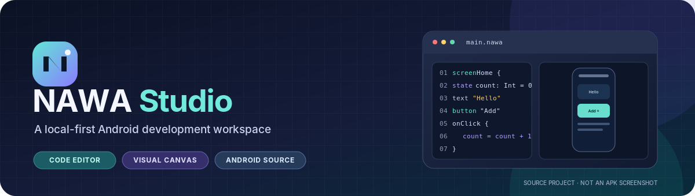
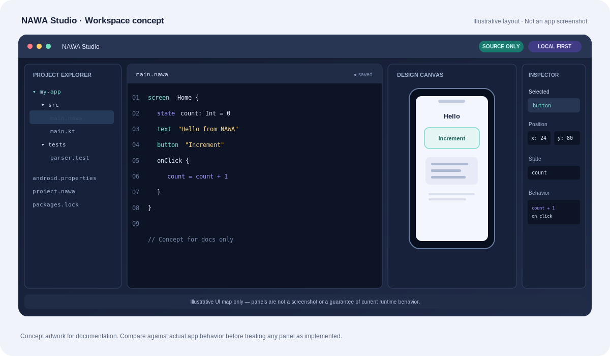
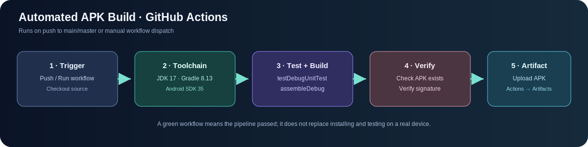
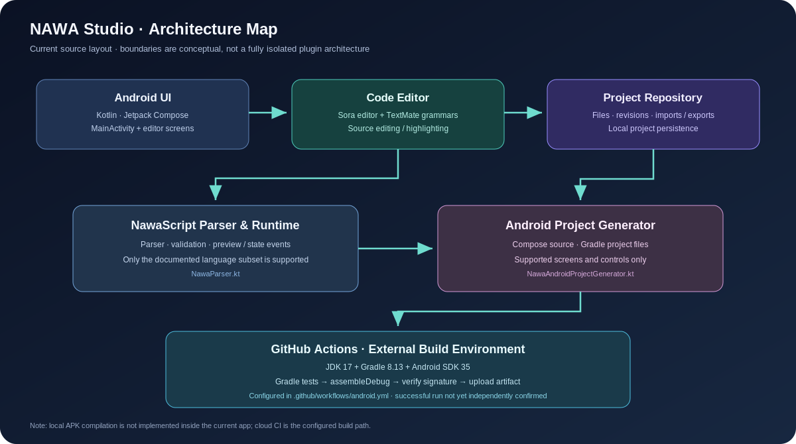

<div align="center">
  
  <h1>نواة NAWA Studio</h1>
  <p><strong>بيئة تطوير Android محلية المصدر، مع محرر كود ومصمم واجهات تجريبي ومولّد لمصدر Android.</strong></p>
  <p>
    <a href="README_EN.md">English</a> ·
    <a href="docs/NAWASCRIPT_AR.md">مرجع NawaScript</a> ·
    <a href="docs/ROADMAP_AR.md">خارطة الطريق</a> ·
    <a href="docs/VALIDATION_AR.md">سجل التحقق</a> ·
    <a href="RELEASE_STATUS_AR.md">حالة الإصدار</a>
  </p>
  <p>
    
    
    
    
    
  </p>
</div>

> **حالة مهمة:** المستودع يحتوي على ملفات المصدر؛ لا يتضمن APK جاهزًا. يوجد سير GitHub Actions مهيّأ لمحاولة بناء نسخة Debug ورفعها كـ Artifact، لكن نجاح تشغيله يحتاج إلى التحقق من صفحة Actions في مستودعك. لم يتم التحقق من تثبيت التطبيق على جهاز Android فعلي.

## المحتويات

- [نظرة عامة](#نظرة-عامة)
- [الصور والخرائط التوضيحية](#الصور-والخرائط-التوضيحية)
- [الميزات الحالية](#الميزات-الحالية)
- [المعمارية](#المعمارية)
- [المتطلبات والبناء](#المتطلبات-والبناء)
- [البناء التلقائي على GitHub](#البناء-التلقائي-على-github)
- [بنية المشروع](#بنية-المشروع)
- [الحدود المعروفة](#الحدود-المعروفة)
- [المساهمة والأمان](#المساهمة-والأمان)

## نظرة عامة

**NAWA Studio** مشروع Android مبني بـ Kotlin وJetpack Compose، يجمع وظائف تحرير الملفات، وكتابة NawaScript، ومعاينة مجموعة محددة من اللغة، وتجهيز مصدر مشروع Android من التركيبات التي يدعمها المولّد. الهدف هو تطوير بيئة محلية قابلة للتوسع، مع الاستفادة من GitHub Actions عند الحاجة إلى بناء APK.

المشروع في مرحلة تطوير مبكرة. لا ينبغي اعتبار وجود محرر أو مُولّد مصدر دليلًا على اكتمال IDE بمستوى Android Studio؛ حدود كل مكوّن موضحة أدناه وفي [سجل التحقق](docs/VALIDATION_AR.md).

## الصور والخرائط التوضيحية

### تصور لمساحة العمل



<sub>هذا رسم توضيحي صُمّم لشرح الفكرة، **وليس لقطة شاشة حقيقية من التطبيق**. لا يعني ظهور أي لوحة في الرسم أن كل وظائفها قد اكتملت داخل التطبيق.</sub>

### خريطة البناء الآلي



### خريطة المكوّنات



<sub>مصادر الرسومات الأصلية القابلة للتعديل موجودة بصيغة SVG داخل `docs/assets/`.</sub>

## الميزات الحالية

| المجال | الموجود في المصدر | الحالة والحدود |
|---|---|---|
| محرر الكود | محرر Sora، تبويبات، حفظ، ترقيم الأسطر، تلوين TextMate للغات متعددة، بحث داخل الملفات | التلوين ليس تحليلًا دلاليًا كاملًا؛ لا يتوفر مصحح أو Language Server شامل لكل لغة |
| إدارة المشروع | إنشاء ملفات ومجلدات، إعادة تسمية وحذف، استيراد موارد، حزم `.nsqpack`، سجل نسخ محلي | يعتمد على حدود وأذونات التخزين في Android؛ يجب التحقق من تدفقات الاستخدام على الجهاز |
| مصمم الواجهات | عناصر أساسية، سحب، إحداثيات `.at(x, y)` في المصدر، معاينة قابلة للتمرير | لا يدعم جميع عناصر Android أو تخطيطات القيود والتجاوب بمستوى احترافي |
| NawaScript | محلل ومعاينة، حالات وأنواع أساسية، شاشات وتنقّل، أحداث وشروط وحساب وحلقات محدودة | لغة تجريبية صغيرة؛ راجع [مرجع اللغة](docs/NAWASCRIPT_AR.md) |
| مولّد Android | تجهيز ملفات مشروع Gradle ومصدر Kotlin/Compose للتركيبات المدعومة | لا يبني APK داخل التطبيق، وصحة المصدر الناتج تعتمد على الكود والإعدادات والاعتماديات |
| CI | سير GitHub Actions لتشغيل اختبارات Gradle وبناء APK والتحقق من التوقيع ورفع الناتج | إعداد السير موجود؛ يجب تشغيله والتأكد من نجاحه في المستودع الفعلي |

## المعمارية

الخريطة المعمارية المعروضة أعلاه تلخص الاتصال بين الواجهة، والمحرر، ومستودع المشروع، ومحلل NawaScript، ومولّد Android. بناء APK يتم في خط CI الخارجي المعرّف في `.github/workflows/android.yml`، وليس داخل التطبيق نفسه. يمكن فتح [ملف SVG الأصلي](docs/assets/architecture-map.svg) عند الحاجة إلى تعديل الرسم.

## المتطلبات والبناء

### المتطلبات

- JDK 17
- Gradle 8.13
- Android SDK Platform 35
- Android Build Tools 35.0.0

### فتح المشروع

1. نزّل الأرشيف وفك ضغطه، أو استنسخ المستودع بعد رفعه إلى GitHub.
2. افتح **مجلد `NAWA-Studio` الذي يحتوي `settings.gradle.kts`**؛ لا تفتح مجلدًا أبًا أو فرعيًا بالخطأ.
3. تأكد أن Android SDK Platform 35 وBuild Tools 35.0.0 مثبتان.
4. من جذر المشروع شغّل:

```bash
gradle --no-daemon testDebugUnitTest assembleDebug
```

بعد نجاح البناء، المسار المتوقع لملف APK هو:

```text
app/build/outputs/apk/debug/app-debug.apk
```

> الأرشيف الحالي لا يحتوي على `gradlew` ولا APK؛ لذلك يجب توفر Gradle على الجهاز أو استعمال سير GitHub Actions المرفق. ولا يعدّ نجاح بناء وحدات Kotlin منفصلة تأكيدًا على نجاح تجميع تطبيق Android الكامل.

## البناء التلقائي على GitHub

ملف سير العمل: [`.github/workflows/android.yml`](.github/workflows/android.yml).

يبدأ سير العمل عند رفع تغييرات إلى الفرع `main` أو `master`، ويمكن تشغيله يدويًا من **GitHub → Actions → Build NAWA Studio APK → Run workflow**. ينفّذ الخطوات التالية:

1. تنزيل ملفات المصدر.
2. إعداد JDK 17 وAndroid SDK وتثبيت Gradle 8.13.
3. تثبيت حزم Android SDK المطلوبة.
4. تشغيل `testDebugUnitTest` و`assembleDebug`.
5. التحقق من وجود APK وصحة توقيعه.
6. رفع الملف باسم `nawa-studio-debug-apk`.

بعد أن يظهر التشغيل باللون الأخضر، افتح التشغيل نفسه ثم قسم **Artifacts** لتنزيل APK. هذا هو **Debug APK** للتجربة، وليس حزمة Release موقّعة بمفتاح نشر خاص بك. إذا فشل التشغيل، راجع أول رسالة خطأ في السجل بدل افتراض أن الرفع وحده أنتج التطبيق.

## بنية المشروع

```text
NAWA-Studio/
├── .github/workflows/android.yml   # مسار بناء APK على GitHub Actions
├── app/src/main/java/com/nawa/studio/
│   ├── MainActivity.kt             # واجهة التطبيق
│   ├── NawaTextMate.kt             # تكامل تلوين المصدر
│   └── core/                       # اللغة، المستودع، التدقيق، ومولّد Android
├── app/src/main/assets/textmate/   # قواعد تلوين اللغات
├── app/src/test/                   # اختبارات وحدات
├── docs/
│   ├── assets/                     # صور SVG والخرائط التوضيحية
│   ├── NAWASCRIPT_AR.md             # مرجع اللغة
│   ├── ROADMAP_AR.md                # خارطة الطريق
│   └── VALIDATION_AR.md             # ما اختُبر وما لم يُختبر
├── scripts/                        # فحوص مساعدة
├── RELEASE_STATUS_AR.md            # حالة الإصدار وحدود التحقق
├── SECURITY_AR.md                  # إرشادات الأمان
└── README.md                       # صفحة المشروع الافتراضية على GitHub
```

## الحدود المعروفة

- NawaScript لغة تجريبية محدودة؛ ليست بديلًا عامًا عن Kotlin أو Java.
- المعاينة تشغّل التركيبات المدعومة من NawaScript، ولا تشغّل Kotlin/Java.
- محرر Kotlin/Java لا يوفّر بعد تحليلاً دلاليًا وإعادة هيكلة وتصحيحًا كاملًا بمستوى Android Studio.
- مصمم الواجهات محدود بالعناصر الأساسية والمواضع المطلقة؛ لا يوفّر محرر قيود كاملًا أو تخطيطات متجاوبة شاملة.
- المولّد يجهز ملفات المصدر ولا يضمن أن كل مشروع مولّد سيُبنى دون تعديلات.
- لم يتم بناء APK أو اختباره على هاتف حقيقي من بيئة إعداد الأرشيف؛ راجع [سجل التحقق](docs/VALIDATION_AR.md) و[حالة الإصدار](RELEASE_STATUS_AR.md).

## المساهمة والأمان

قبل إرسال تعديل، راجع [دليل المساهمة](CONTRIBUTING_AR.md) و[سياسة الأمان](SECURITY_AR.md). لا تضع رموز وصول GitHub أو مفاتيح API أو كلمات مرور داخل المصدر أو ملفات README. استخدم **GitHub Secrets** عند الحاجة إلى أسرار في CI.

---

<div align="center">
  <sub>NAWA Studio · مشروع قيد التطوير · توثيق صريح للميزات الحالية والحدود المعروفة</sub>
</div>
